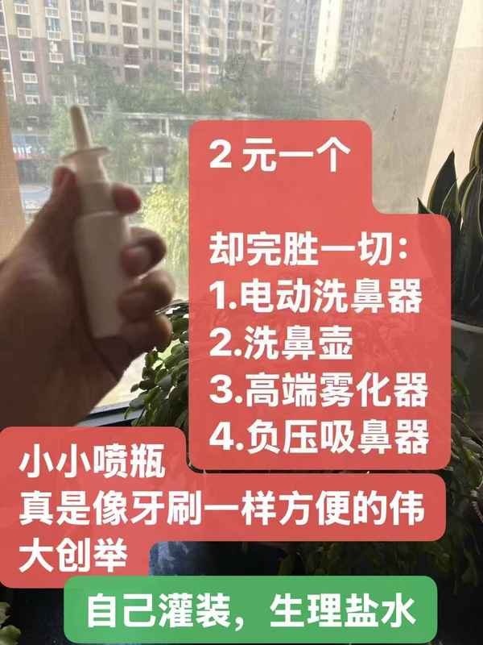
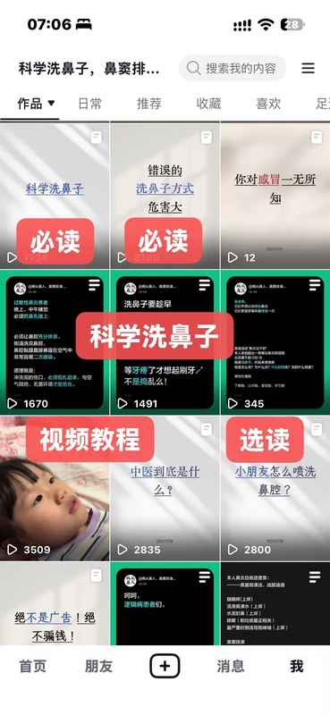
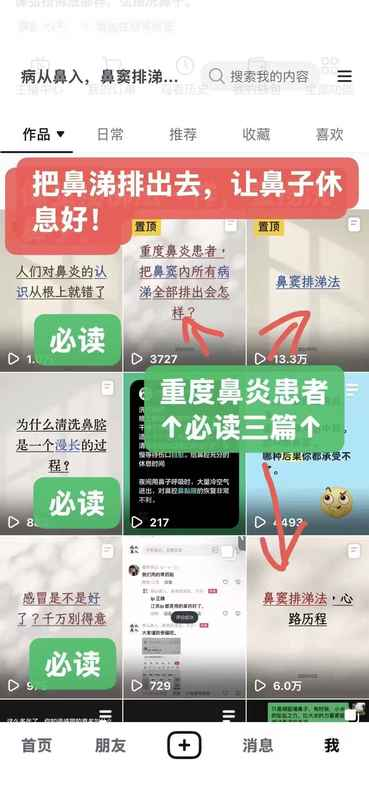

# 揭开“免疫力”的“骗局”

在跟鼻炎、鼻窦炎不断斗争的实践过程中，

我对“免疫力”这个词，

越来越持有怀疑的态度

总是有一个声音，不断反复地向我灌输，是我体质不好，免疫力低下。

抵抗力这种词汇，总是让我错误地认为我身体里那支抵抗细菌病毒的免疫军队战斗力低下，打不过敌人。

你要多锻炼身体，多补充营养，增强了免疫力，你的免疫大军这支队伍有了强大的武装力量，就能对抗疾病！

这是多么愚蠢荒唐的笑话啊！

大禹治水的故事，家喻户晓，响彻中华大地。

大禹的父亲，鲧，因为治水不利被处死！

从鲧的肚子里孕育出一代英雄大禹，

用了完全不同的思路，彻底解决了水患！

洪水不是敌人

不能用堵的思路，更不可能打，怎么能把水当成战场上那样的敌人呢？

你需要泄洪排淤，疏通水道

鼻窦炎正是这样的一种疾病。

用免疫力，抵抗的思路解决这个疾病，犹如大海搏击。对空挥拳，毫无意义！

靠运动，用药获得的偶然的舒适感，这种暂时的片刻安宁，却进一步误导我们，果然可以通过运动，用药提高免疫力，抵抗力。

鲧用息壤，当然也能暂时堵住洪水，于是鲧就更加依赖息壤，息壤的暂时功效，使得他在这条路上越走越远，直到迎来命运的终结！

舜登用，摄行天子之政，巡狩。行视鲧之治水无状，乃殛鲧于羽山以死。

在鼻腔左右、背后，有八个鼻窦窦腔，正像八个蓄水池，有鼻窦管与鼻腔相通。

其实还有两个咽鼓管与中耳相通

两个鼻泪管与眼睛相通

共 12 根管道。

这完全就是是一个四通八达的水利系统。

尤其是鼻窦，鼻窦炎患者的这八个蓄水池，已经被污染殆尽，充满污水。

给污水池中用药，靠运动健身，增强蓄水池内壁的免疫力，抵抗力？这样肯定是不行的。

唯一的思路就是给蓄水池换水，排污！

可是如何排污？如何换水？如何疏通管道？

鼻腔长期遭受污染物刺激，已经很敏感了，遭不住更多的外来刺激了。

去医院做手术，打麻药？可是手术过程对鼻腔鼻窦的破坏，术后能恢复几何？术后的并发症也许更痛苦。

有没有一种更温和的排污手段？

当然有啊，

很久以前，网上就流传一种叫“泡窦法”的方法。

但是很不幸，它从来都没有被大面积传播，以至于我无所耳闻，使我空误如此多年。

五年来，我一直坚持洗鼻子，虽然效果显著，但是不能断根，坚持简单冲洗鼻腔的收益一直停滞在这里：

✅1、眼睛痒，春秋换季只会轻微发作，完全可以接受

✅2、流清鼻涕水，减少 90%，但直风对吹，必流

✅3、头疼，非常轻微

✅4、鼻子痒，大有改善，早上起来会打一阵喷嚏，

✅5、打喷嚏，同上

✅7、咳嗽，大有改善

❌6、水泥封鼻，就是这个鼻塞，怎么也好不了

❌8、吐痰，吐痰量怎么也少不了

✅9、最严重时鼻涕倒流导致哮喘，上岸，洗鼻后再无哮喘

春秋两季，更是小心谨慎，也难以避免咳嗽加重。

但是鼻窦排涕法，却让我大有收益，

最后两项，在在今年入秋以来，有了质的改善。

鼻窦排涕法的具体操作方法，和心路历程，我已经在主页别的文章中有介绍了，有需要了解的可以移步前往查看。

再顺手更新一下我的鼻窦排涕进度表吧:

鼻窦排涕

第一阶段、

开窦口(完成)

这个阶段，具体用了多少时间已经忘了，大概累计 10 天？

第二阶段、

大量排涕，像泄洪一样持续好几(完成)

这个阶段大概 6～8 天，中秋三天，到 10 月 1

第三阶段、

还是有残余黄涕没有彻底排完(大致)

10 月 7 日 持续 6 天？

第四阶段、

没有大量黄涕，只有残留黄鼻涕丝(进行中…)

这个至今

第五阶段、

今天已经基本不见黄鼻涕丝，全是清样鼻涕。

近三天我有服用小青龙汤，橘红痰咳颗粒，感觉对我自己挺有效。

在第三阶段时，就已经感觉鼻子很通气了，不会再水泥封鼻了。

现在更是好多了，完全可以自由呼吸，

但是安全起见，夜间睡觉，我还是坚持堵住鼻孔。

