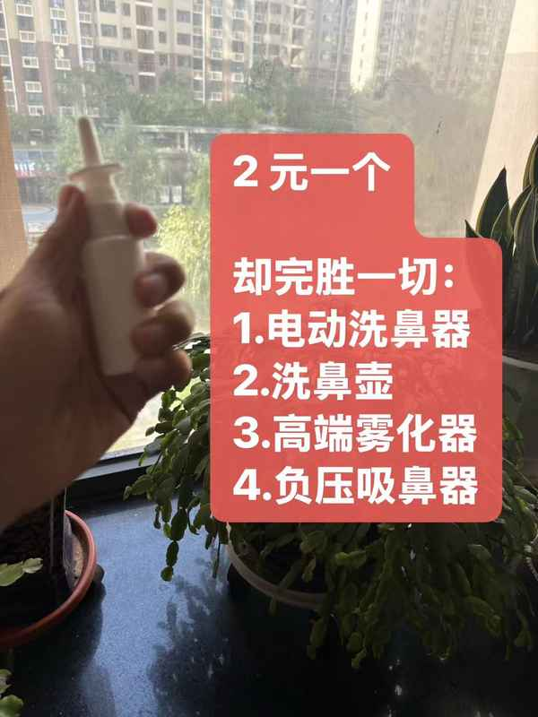
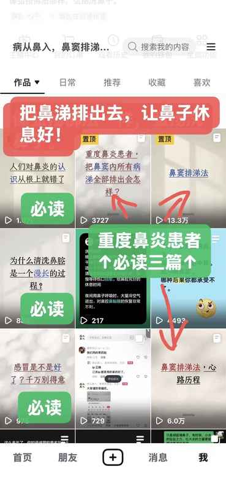

# 错误的洗鼻子方式危害大

错误方式洗鼻子，危害无穷

一、大水冲鼻

大水冲洗，因为不舒服，往往因为希望速战速决，持续时间短，挂在鼻腔壁的鼻痂还没来得及软化，洗鼻子进程就结束了。还浪费盐水。对付顽固鼻痂，小水慢炖更奏效。

二、自己兑盐水

自己兑盐水，浓度掌握不好，浓度太低容易呛鼻子，浓度太高容易产生腌咸菜效应。水不干净，容易感染伤口，炎症鼻腔就是有伤口。

三、凉水过鼻

凉水洗鼻，大量冰凉生理盐水过鼻腔，会急剧带走鼻腔内热量，给细菌繁殖创造条件。

四、用力哼鼻涕

用力哼鼻子，可能将鼻涕水+细菌反向推入中耳，引发中耳炎。反向推入鼻窦口，引发鼻窦炎。

五、鼻孔朝下

错误的洗鼻姿势，鼻孔朝下，只能清洗到鼻腔前鼻，鼻涕鼻痂依旧挂在鼻腔深处，病涕持续刺激鼻黏膜，流到咽喉引起咳嗽，刺激鼻甲引起鼻甲肥大，刺激扁桃体引起扁桃体肥大，刺激腺样体引起腺样体肥大……

六、复杂麻烦的洗鼻工具

用打火机点很方便，煤气灶点烟很不方便。各种洗鼻壶，洗鼻器，负压的，雾化的，都太麻烦。

仪式感太重，准备工作做好久，麻烦使人放弃！

牙刷是人类发明的最伟大的工具，伟大之处就在于它的方便易用。

七、怀疑

因为以上种种原因，导致洗鼻子效果差，甚至反受其害，对洗鼻子失去信心，怀疑洗鼻子的作用，最终放弃。寻求其他治疗方法，都是缘木求鱼。

八、怀疑

洗鼻子过程中出现各种状况，难受，不舒服的感觉加重，就怀疑洗鼻子的效用，放弃。

九、不堵鼻孔

洗完鼻子不堵鼻孔，危害更大，受伤的鼻腔黏膜直接暴露在空气中，就和清洗完的伤口不包扎一样，接触空气，更容易造成二次感染！

小朋友可以不堵，小朋友大度没有过敏性鼻炎症状，鼻腔黏膜大度都较好。有条件的，还是堵上。和包扎伤口一个道理，很重要

十、清洗时间不够

简单冲洗鼻腔，修复鼻腔黏膜，进度是按年计的，半年起步，一年打底。好了之后，也要隔三差五，至少一周清洗一次。

十一、排涕不彻底

重度鼻炎患者，简单冲洗鼻腔效果非常有限，可以考虑"鼻窦排涕法"，高强度排涕，过程非常艰辛。鼻窦内的病涕并不是无限子弹，高强度排涕，可以把病涕排完。本人亲测！

十二、正确洗鼻方式

就用手动小喷瓶，

就用手动小喷瓶，

就用手动小喷瓶，

坐着、躺着、站着都可以

仰头，鼻孔朝天，

喷入生理盐水 3～15+ 喷，自己凭感觉而定，让生理盐水顺着鼻腔深入到鼻腔深处。然后从嘴巴吐出来，吐不出来，就要慢慢学，有的堵的厉害就轻轻吸一吸，吹一吹，吹泡泡，都可以，逗鼻涕。各种办法弄出来。用卫生纸擤出来。都可以。

少量多次，慢慢弄。

小水慢炖，和小火熬粥一样，慢慢来。

大人小孩都适用，

小孩可以从喷一下开始，非常容易接受。

大人，重度鼻炎，也最多喷几下或者十几下。

软化稀释后的鼻涕弄出来以后再喷下一轮。

