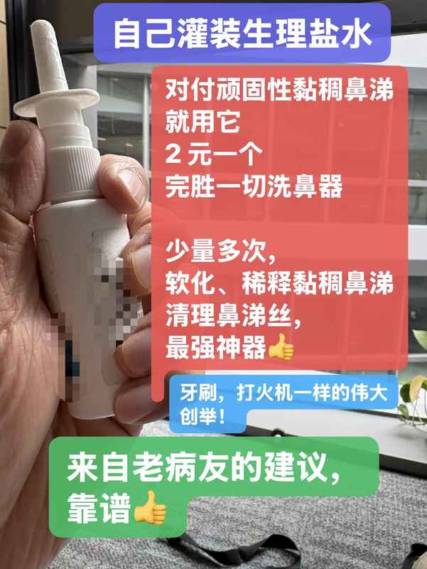

一、

粘附在鼻渊深处，鼻窦口外部，挂壁在鼻咽部位的非常黏腻的，强力胶水一样，粘附性极强的鼻涕。

这种鼻涕，靠大水猛灌，

短时间内它是冲不走的，

就像河底的水草，黄河的淤泥一样，

河水再大，即使洪水泛滥

也难以带走水草，淤泥。

1、

市面上主流的洗鼻器们，都要求你鼻孔朝下，靠大水漫灌，甚至要脉冲加压。

可是只要你鼻孔朝下，你就是再怎么努力，也无济于事，水流再大，压力再强，很难冲洗到鼻渊深处，够不到鼻窦口，鼻咽部位。

2、

或者你用雾化器，怼住鼻子嘴巴，很多小朋友用雾化器的时候，只用嘴巴呼吸，不用鼻子呼吸，生理盐水还是接触不到鼻渊深处，鼻窦口，鼻咽部位。

3、

那种包裹胸部，震荡排痰器，更是只能带走已经倒流入肺部的那部分痰液。更无法接触到鼻渊部位。

4、

负压吸鼻器，利用负压气流，可以带出来松软的鼻涕，但是对挂壁鼻涕丝，黏稠度再高一点的鼻涕，就无能为力了。它同样够不到鼻渊，鼻窦口，鼻咽部位。

结论：

以上四种方式都完美地避开了洗鼻子最应该清洗的核心部位。而最顽固黏腻的鼻涕，也恰恰就集中堆积在鼻渊深处，鼻窦口，鼻咽部位。

二、

那种大水冲出来的一大块黄脓鼻涕，固然痛快。

可是依然不够，他只是情况较好的情况。

鼻涕丝，黏腻鼻涕，依然是常有的情况。

尤其是成年人，老鼻窦炎患者。

短时间，大水冲洗，

对他就完全无效了。

三、

这时候小喷瓶的威力就显现出来了

牙刷，打火机(火柴)，真的是世界性的伟大创举！

毫不夸张地说，小喷瓶，这是这样的伟大创举！

用小喷瓶清洗鼻腔：

0、!!!必须鼻孔朝上!!!

躺着，站着，坐着，走路，都可以，

仰头，鼻孔朝上。

1、非常节省生理盐水，3～5 喷，不会呛水呛咳

2、少量多次，少量多次，少量多次

3、方便携带，随时、随地、随手喷洗

4、仰头，鼻孔朝上的喷洗姿势，可以让生理盐水沿着鼻腔顺流而下，直达鼻渊深处，鼻窦口，鼻咽部位。

5、对于粘附性较强的黏腻鼻涕，3～5 喷生理盐水，喷进去，既不会因为太多而直接流走，又能刚好和黏腻鼻涕汇合，泡着，让时间来软化稀释它们。

6、对于干结的鼻痂就更需要时间浸泡软化。

7、随时、随地、随手、随心、随意，3～5 喷主打一个补水、软化、保湿、稀释。鼻涕大了自然松软，松动。

此时乘机，重点加强 10～20 喷，一举冲洗，鼻涕就出来了…

四、

小小鼻腔，里面的实际情况复杂多变，有时堆满鼻涕，有时透气通畅，有时干燥结痂，鼻甲肥大，鼻腔黏膜充血红肿，窦口堵塞窦腔膨大。

各种情况错综交汇。

小喷瓶能应付绝大多数状况 99%

任你复杂多变，我自一招鲜。

五、

唯一的缺点，就是鼻孔朝上，有时候生理盐水会顺流直下，直灌喉咙引起呛咳，这个时候要稍微注意，有一点小技巧不好描述，但是多喷几次，大多数人都能很快掌握习惯。

少量生理盐水绝对不会引起剧烈呛咳，小喷瓶的优点还有一个，就是可以从喷一下开始，根据一下一下增加，安全指数拉满。

六、

少量多次，少量多次，少量多次

随时随地随手，随时随地随手，随时随地随手
