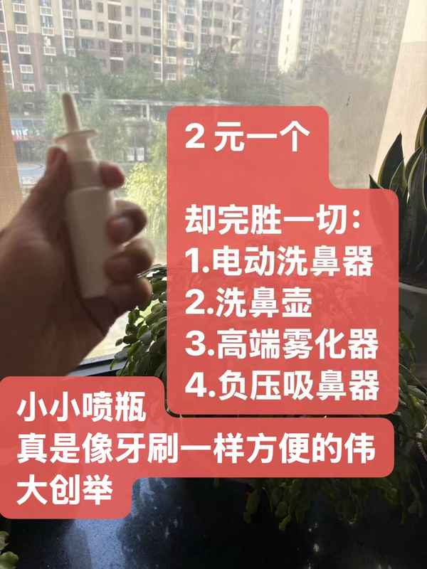
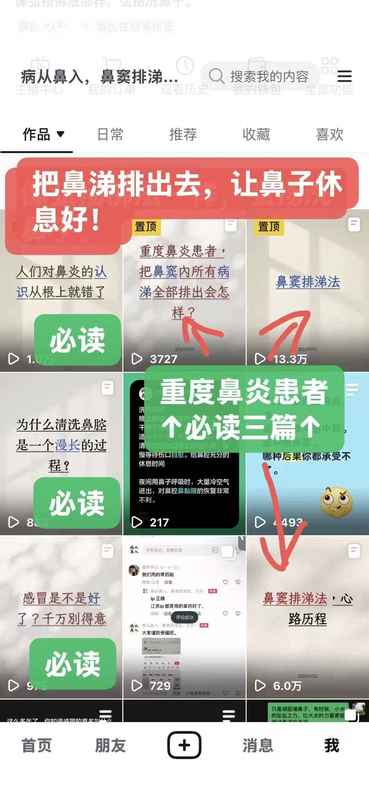

到底怎么样才算是科学洗鼻子？

洗个鼻子很简单。

就跟打火机点烟一样，嘎嘣一下就点着了。

洗鼻子也是，呲呲两下就喷进去了。

重要的是思路。

鼻炎主要分两种症状

一种是过敏性鼻炎

一种是鼻窦炎

针对这两种症状，有两种完全不同的思路

**思路一：具体操作办法**

针对过敏性鼻炎

修复鼻腔黏膜，

就是早中晚三次，每次喷洗 1-3分钟，具体喷几下自己视情况而定，

每天多喷洗几次，多喷洗一会，完全没有问题。

因为生理盐水本身就能喝。。

想喷就喷。

坚持半年起步，一年打底，

见效慢，但治根。

要想鼻腔黏膜修复加速，就夜间睡觉把鼻孔堵上。

为什么堵鼻孔？

道理就是：

因为盐水冲洗伤口后，立即包扎伤口，避免和空气接触，造成二次感染。。

**思路二：具体操作办法**

针对鼻窦炎，

就要做鼻窦排涕法

每天晚上，准备:

一个塑料袋

卫生纸

喷雾瓶

躺床上

给鼻孔喷生理盐水

稀释软化鼻涕，

然后想办法

擤出来

吐出来

轻轻吸出来

哼出来

想尽一切办法弄出来

每天晚上吐大半塑料袋

鼻涕水+卫生纸+生理盐水

重度鼻窦炎 10 天打底，

20 天正常

周末可以一整天躺家里做排涕

轻度鼻窦炎说不定半路就排完了

一定要坚信，鼻窦内的病涕它并不是无限子弹，一定能排空。

排涕中途，大概率会鼻腔深处刺裂难耐，休息好了，缓过来继续排涕。。

鼻窦炎，排涕完

夜间必须把鼻孔堵上。。

让鼻子休息

光有操作办法是不行的。

还要理解为什么要这样操作。

第一，修复鼻腔黏膜，它的原理是什么？

受损的鼻腔黏膜就像受伤的伤口，用盐水冲洗后需要包扎起来，与空气隔绝，避免二次感染，在无菌环境下，伤口才能自愈。你的伤口不是靠什么药物治好的，而是在无菌环境下，伤口它自己自愈了。

所以堵住鼻孔非常重要。堵住鼻孔就等于包扎伤口。

第二，鼻窦排涕，为什么要做鼻窦排涕？

你从网上听到的所有说法，都是鼻子里的鼻涕是无限的，刚弄通气，就又堵住了。怎么做都不管用。

可是你有没有想过一个问题？

鼻窦中的鼻涕到底是不是无限子弹？到底能不能彻底排空？如何才能彻底排空？

正是这个问题，引出了鼻窦排涕法。

这也是一次大胆的尝试。

长时间高强度地对鼻窦口的病涕进行引流排涕

持续十几天，每天晚上坚持两三个小时。

每天都吐大半袋子鼻涕水，加盐水、加卫生纸，累计大半袋子。

这样的尝试，似乎从来都没有人敢这么想，敢这么做过。也许有人做了，但他并没有宣扬出来，也没有把它总结成一套方法。

然而现实是，很多鼻炎患者都是小朋友。

针对小朋友，情况又相当不同。

小朋友自主洗鼻能力较差，

必须大人协助清洗鼻腔。

小朋友也不愿意堵鼻孔。

其实，小朋友的情况比成年人的情况要好得多。

堵鼻孔并不是必须的。

只需要盐水过鼻，简单清洗就行了。

我有鼻窦炎，盐水过鼻时就会把挂在鼻窦口的病涕带走。

小朋友清洗鼻腔的重点是在冬天和夏天，还有鼻炎初愈后。还有春秋两季感冒高发季的前期。预防性的清洗鼻腔。

小朋友在感冒期间、鼻炎发作期间，着急忙慌地洗鼻子，想要快速见效。这种焦虑是完全没有必要的，正常的病程就让它正常进行就行了。谁还没有得过几次感冒呢？

就跟你牙疼了才想起刷牙是没有用的。他已经晚了

幸运的是，小朋友的乳牙掉了，还能长出来新牙。

洗鼻子本身很简单

只有明白其中的道理。才能更有理由去坚持。

才知道自己在干什么。

否则轻易放弃，就会前功尽弃。

中途遇到点情况，就怀疑洗鼻子是不是有效。

就去寻求其他办法，都是缘木求鱼。
